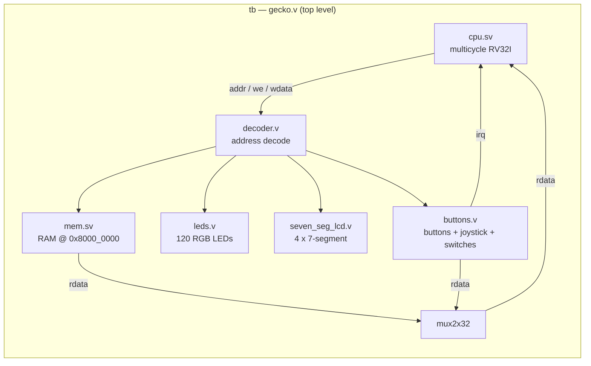
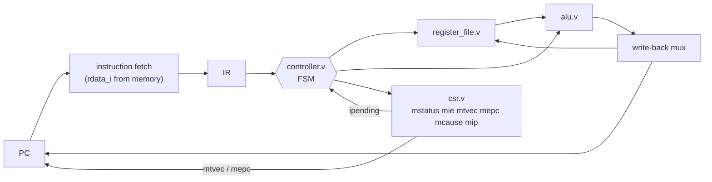
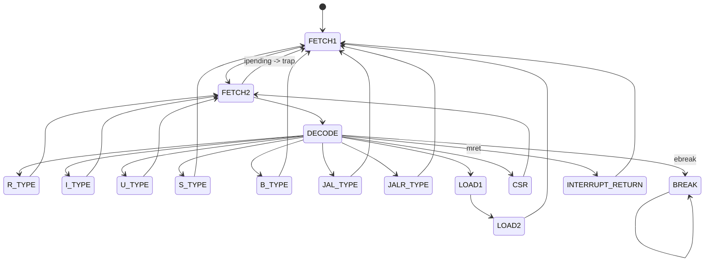

# RISC-V Multicycle CPU with Peripherals and Interrupts

A multicycle RV32I processor with memory-mapped peripherals and machine-mode interrupt
support, plus an interactive terminal front-end that runs the real hardware model.

## Quick start

```sh
make demo    # scripted LOSE -> interrupt -> WIN walkthrough (no TTY required)
make play    # interactive board: you press the buttons, the LEDs are the display
```

Both drive the actual elaborated HDL through Verilator. The CPU executes `program.s` for
real; the front-end only ties the terminal to the board's pins.

Docker (the container entrypoint is `make`):

```sh
docker run --rm -it -v "$PWD:/workspace" -w /workspace riscv-multicycle-cpu play
docker run --rm    -v "$PWD:/workspace" -w /workspace riscv-multicycle-cpu demo
```

## Interactive board (`make play`)

`make play` renders the 120-LED panel and the four seven-segment displays live, next to a
CPU/CSR panel (PC, current instruction, registers, `mstatus` / `mie` / `mtvec` / `mepc` /
`mcause`, game state) and the current button / joystick / switch state.

Each round gives you a short countdown, shown on screen as a `TIMER` bar. Press `c` or
`Enter` before it empties and the button interrupt fires: the game state flips from `LOSE` to
`WIN` and the LEDs turn green. Miss it and they turn red. The firmware then starts the next
round, so you can keep playing; `R` restarts the simulation at any time.

| Key | Action |
|-----|--------|
| `c` / `Enter` | Center button (triggers the interrupt) |
| `t` `b` `l` `r` | Top / bottom / left / right buttons |
| arrow keys | Joystick up / down / left / right |
| `p` | Joystick press |
| `1`..`8` | Toggle the dip switches |
| `space` | Run / pause |
| `.` | Single-step one cycle |
| `R` | Reset (hardware reset, no rebuild) |
| `q` | Quit |

`make demo` runs the same renderer non-interactively and prints LED summaries such as
`[120R 0G 0B]`, so it is safe in CI.

## Features

- A multicycle RV32I CPU and controller.
- CSR support for machine-mode interrupts (`mstatus`, `mie`, `mtvec`, `mepc`, `mcause`, and `mip`).
- A button peripheral capable of generating interrupts.
- LED and seven-segment display peripherals.
- Memory-mapped memory and peripheral access.
- A RISC-V assembly program that configures interrupts, handles button input, updates game state, and displays the result.
- Verilator/DAP integration in `src/` for simulation and debugging.
- An interactive terminal board (`make play`) and a scripted `make demo` walkthrough.

## Architecture

The SoC instantiated by the testbench (`gecko.v`):



Inside the CPU the controller sequences a single shared datapath across several cycles:



The control FSM (abridged): the `FETCH2 -> FETCH1` edge when `ipending` is set is how a
machine-mode interrupt is taken - the PC switches to `mtvec` and `mepc` captures the
interrupted address.



## Memory map

| Region    | Base         | Decoded by                         | Notes |
|-----------|--------------|------------------------------------|-------|
| RAM       | `0x8000_0000`| `addr >= 0x8000_0000`              | Code, data and stack (`sp = 0x9FFF_FFC0`). |
| LEDs      | `0x5000_0000`| `en_leds` (2 KiB window)           | 120-bit RGB panel; write bit 8 = red, 9 = green, 10 = blue. |
| 7-segment | `0x6000_0000`| `en_7_seg_lcd` (4 KiB window)      | Four packed 8-bit segment values. |
| Buttons   | `0x7000_0000`| `en_buttons` (4 KiB window)        | `+0x0` value, `+0x4` source/clear, `+0x8` push trigger mode, `+0xC` switch trigger mode; sources drive the CPU `irq`. |

## Repository layout

| Path | Contents |
|------|----------|
| `cpu.sv`, `controller.v`, `alu.v`, `csr.v`, `register_file.v`, `pc.v`, `ir.v` | The processor |
| `decoder.v`, `mem.sv`, `leds.v`, `seven_seg_lcd.v`, `buttons.v` | Memory + peripherals |
| `gecko.v` | Testbench / SoC top (`tb`) |
| `program.s`, `mmio.ld` | Firmware and linker script |
| `src/verilator.cpp` | Shared Verilator harness (`sim_t`) |
| `src/smoke.cpp` | Headless pass/fail test (`make test`) |
| `src/play.cpp` | Interactive board + demo (`make play` / `make demo`) |
| `src/debugAdapter.cpp` | DAP debug server (`./Vtb`) |

## Requirements

- GNU Make
- Verilator 5.x or later
- A RISC-V RV32 toolchain at `/opt/riscv/bin` with the `riscv64-unknown-linux-gnu-` prefix
  (`gcc` and `objcopy`)
- A C++20 compiler and the libraries required by the Verilator debug adapter

### Docker

Docker avoids installing the Linux toolchain and libraries directly.

```sh
docker build -t riscv-multicycle-cpu .
docker run --rm -v "$PWD:/workspace" -w /workspace riscv-multicycle-cpu build_gecko
```

## Build and run

```sh
make build_gecko   # assemble program.s into out/gecko.bin, then build the testbench
make test          # headless smoke test against the real CPU; ends with "Simulation result: PASS"
make play          # interactive board
make demo          # scripted lose -> win walkthrough
make clean         # remove generated output
```

`build_gecko` produces `./Vtb`. `play`/`demo` use a separate build directory (`out/obj_play`),
so they do not disturb the `Vtb` artifact.

## Debugging

`./Vtb` is a Verilator DAP server. It exposes registers, memory, the PC, LEDs, the
seven-segment displays and button inputs, and waits for a DAP client (for example the VS Code
debug configuration) on standard input. `Ctrl-C` stops it.

The Docker equivalent:

```sh
docker run --rm -v "$PWD:/workspace" -w /workspace --entrypoint ./Vtb riscv-multicycle-cpu
```
